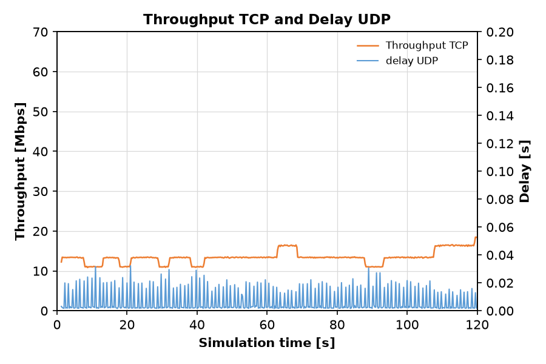
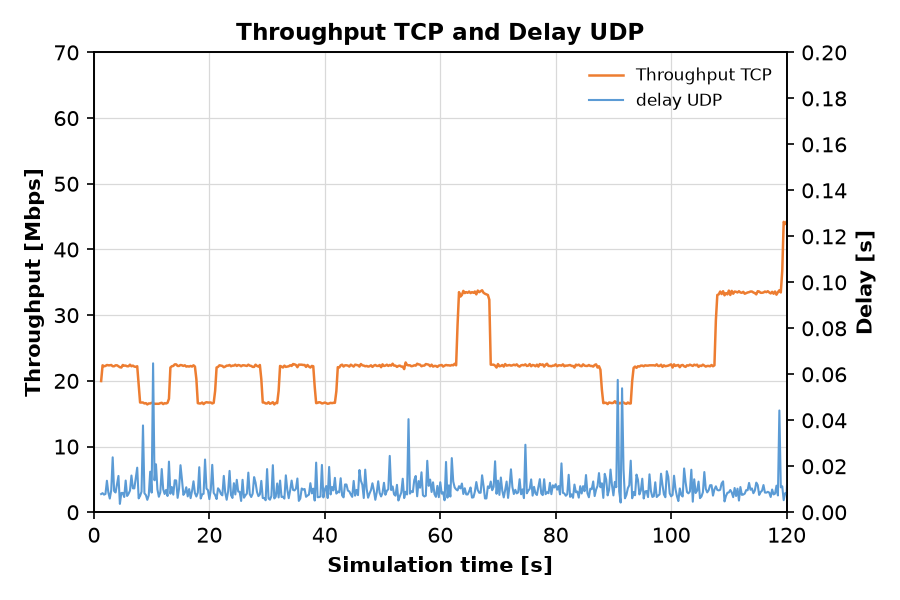
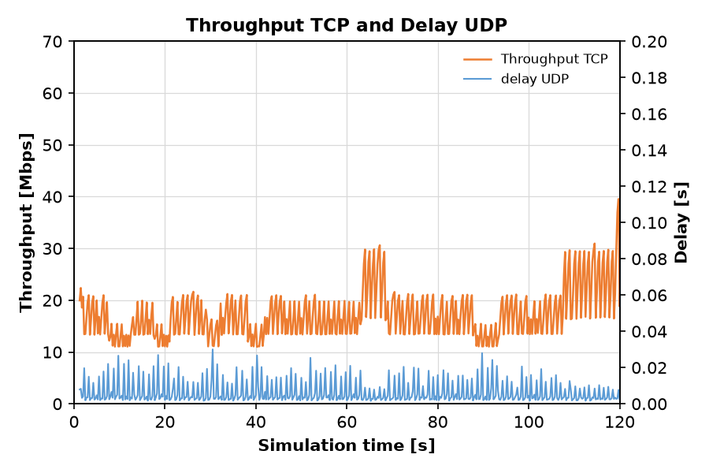
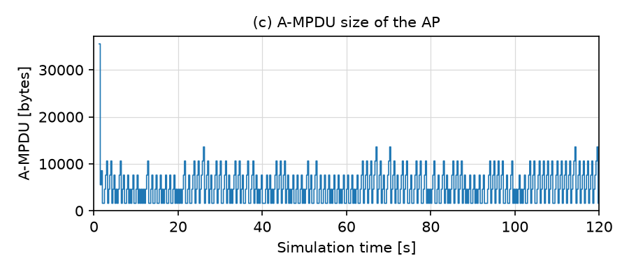

# Finding the Sweet Spot for Frame Aggregation：移植到 ns-3.48 與重現實驗報告

## 1. 背景

本報告重現的論文是：

> J. Saldana, O. Topal, J. Ruiz-Mas, J. Fernandez-Navajas, "Finding the Sweet Spot for Frame Aggregation in 802.11 WLANs," *IEEE Communications Letters*, vol. 25, no. 4, pp. 1368–1372, April 2021.

論文探討 802.11 的 A-MPDU 聚合在 **TCP 吞吐量** 與 **VoIP 延遲** 之間的取捨，並提出一個動態演算法：AP 每 0.25 秒量測一次底下 VoIP 使用者的延遲，超過延遲預算（latency budget）就調降 A-MPDU 上限，低於預算就調升。

作者公開的程式（`cc/*.cc`、`sh/*.sh`）是在 **ns-3.30.1 + waf** 上撰寫的。我們的環境是 **ns-3.48 + CMake/`./ns3`**，兩者之間 Wi-Fi 模組的 API 改動很大，因此必須先移植才能執行。

| 項目 | 內容 |
|---|---|
| 原始程式 | v199（論文主要版本）、v199b、v199b11–b16（演算法係數不同）、v215 |
| 移植範圍 | 全部 9 個 `.cc`、21 個 `sh/*.sh` |
| 執行環境 | ns-3.48、Apple M5（10 核心）、macOS、build profile：optimized（release） |
| 程式碼位置 | 分支 `ns-3.48-port`，git@github.com:soraimahiro/wifi-sweet-spot-ns3.git |

## 2. 移植到 ns-3.48 的修改

### 2.1 建置方式

- 新增 `CMakeLists.txt`：把 `cc/` 底下每個 `.cc` 各編成一個獨立的執行檔。原本 `cc/` 的檔案完全不會被 ns-3 的 scratch 機制編譯；就算被編譯，9 個 `main()` 也會互相衝突。
- `sh/*.sh`：`./waf -d optimized --run` 改成 `./ns3 run`，並在開頭 `cd` 到 ns-3 根目錄，讓腳本可以從任何目錄執行。

### 2.2 API 變更（不改就編譯失敗或執行時中止）

| ns-3.30.1 寫法 | ns-3.48 改法 |
|---|---|
| `YansWifiPhyHelper::Default()`、`SpectrumWifiPhyHelper::Default()` | 直接用建構式 |
| `WIFI_PHY_STANDARD_80211n_5GHZ` 等列舉 | `WIFI_STANDARD_80211n` 等；頻段改由頻道設定決定 |
| PHY 屬性 `ChannelNumber`、`ChannelWidth`（已變成唯讀）、`SetChannelNumber()`（已移除） | 改用 `ChannelSettings` 屬性，例如 `"{36, 20, BAND_5GHZ, 0}"` |
| PHY 屬性 `ShortGuardEnabled` | 移除（預設就是關閉） |
| `WifiPhy::EnergyDetectionThreshold` | 改名為 `WifiPhy::RxSensitivity` |
| `TcpWestwood` + `ProtocolType=WESTWOODPLUS` | `TcpWestwoodPlus` |
| `InetSocketAddress::SetTos()`（已移除） | 改設定 client 應用程式的 `Tos` 屬性 |
| `UdpTraceClientHelper(socket位址, port, "")` | `UdpTraceClientHelper(socket位址, "")`；舊寫法在 3.48 會直接 `NS_FATAL_ERROR` |
| `Ptr == 0`、`isnan()` | `Ptr == nullptr`、`std::isnan()` |
| 把變長陣列（VLA）傳給 `Simulator::Schedule` | 改傳 `static_cast<FlowStatistics*>(x)` |

### 2.3 靜默失效的問題（能編譯、能跑完，但結果是錯的）

這類問題最危險，因為程式不會報錯。以下三個都是在實際執行、檢查輸出之後才發現的：

1. **`RegularWifiMac` 路徑失效 → A-MPDU 從來沒被修改**
   原程式用 `Config::Set(".../Mac/$ns3::RegularWifiMac/BE_MaxAmpduSize", ...)` 修改 A-MPDU。`RegularWifiMac` 在 ns-3.36 之後已經不存在，這個路徑比對不到任何物件，`Config::Set` 卻**不會報錯，只是什麼都不做**。
   修正：拿掉 `$ns3::RegularWifiMac/`，並改用 `Config::SetFailSafe`，找不到物件時直接中止，避免再次靜默失效。

2. **MAC 位址比對失敗 → 演算法以為 AP 底下沒有 VoIP 使用者**
   AP 的 MAC 是用 `Address` 的格式存成字串（`類型-長度-MAC`），STA 端比對時則是手寫前綴 `"02-06-" << mac`。在 3.30，MAC 位址的類型編號剛好是 02；但 3.48 的類型註冊順序不同，變成 01，所以兩邊永遠比對不到。
   結果是演算法讀到的 VoIP 最高延遲永遠是 0，A-MPDU 永遠停在 65535。修正後改用 `Address(mac)` 產生字串，和 AP 端的格式一定一致。這個問題也會影響 Disable algorithm 和換手時查詢頻道的邏輯。

3. **未初始化的變數**
   `uint32_t number_of_STAs_per_row;` 宣告時沒有給初始值，沒有在命令列設定時，它的值就是記憶體殘留的隨機內容。smoke test 時剛好是 0，但跑 `test431.sh` 時變成非 0，參數檢查就拒絕執行。這是原作者程式本來就有的 bug，在 3.30 只是碰巧沒發作。修正為 `= 0`。

### 2.4 驗證

用 `run.sh`（Method #1 的參數，4 個 AP、TCP 和 VoIP 各 2 個使用者、模擬 10 秒）確認演算法確實在運作。有 VoIP 使用者的 AP #3，A-MPDU 會隨延遲調整：

| 時間 (s) | VoIP 最高延遲 | A-MPDU (bytes) |
|---|---|---|
| 1.25 | 12 ms（超過 4 ms 預算） | 65535 → 35535 |
| 1.50 | 10 ms | → 5535 |
| 1.75 | 4 ms | → 8535（調升） |
| 2.00 之後 | 在預算上下來回 | 在 1600 到 7600 之間來回 |

修正前後的同一場景比較：

| | VoIP 平均延遲 | TCP 下載總吞吐量 |
|---|---|---|
| 修正前（A-MPDU 實際上一直開到最大） | 12.7 ms | 49.8 Mbps |
| 修正後（動態演算法有在運作） | 5.7 ms | 37.2 Mbps |

方向和論文一致：犧牲一部分 TCP 吞吐量，換到 VoIP 延遲降低約一半，並貼近 4 ms 的預算。

## 3. 實驗 A：Fig. 2（單一使用者的時間序列）

### 3.1 設定

依照 README，Fig. 2 由 `test451`、`test452`、`test453` 產生，取 seed 2。我們寫了 `fig2.sh`，用完全相同的參數只跑 seed 2，再由 `plot_fig2.py` 依照論文的樣式畫圖。

| 共同設定 | |
|---|---|
| 拓樸 | 1 個 AP |
| 使用者 | 1 個 TCP 下載使用者、1 個 VoIP 上傳使用者（隨機走動，速度 1 m/s） |
| 標準 | 802.11ac、5 GHz、20 MHz、單串流、SpectrumWifiPhy、IdealWifiManager |
| 模擬時間 | 180 秒（圖上顯示前 120 秒，和論文相同） |
| 亂數 | `RngRun=2` |

| 子圖 | 聚合設定 |
|---|---|
| (a) | 不聚合 |
| (b) | 一直聚合，A-MPDU 上限 65535 bytes |
| (c) | 動態演算法 Method #1（線性調降、線性調升，`methodAdjustAmpdu=0`，步長 3000 B），延遲預算 4 ms |

三次 run 總共只需要約一兩分鐘。

> **注意：(c) 的參數和作者公開的腳本不同。** 論文正文寫明 Fig. 2(c) 使用的是 **Method #1**（程式參數 `methodAdjustAmpdu=0`）。但 README 標示產生 Fig. 2(c) 的 `test453` 腳本設定的是 `methodAdjustAmpdu=3`，在程式裡對應的是幾何調整（×2 / ×0.618），也就是論文的 Method #2（test521–526 用的就是這個值）。作者公開的腳本和論文的圖可能不是同一個版本。我們以論文正文為準，(c) 使用 Method #1；照 test453 參數（Method #2）跑出的結果也一併列在 3.3 節供參考。

### 3.2 結果

前 120 秒（和論文的顯示範圍相同）：

| | TCP 平均吞吐量 | UDP 平均延遲 | UDP 最大延遲 |
|---|---|---|---|
| (a) 不聚合 | 13.4 Mbps | 6.1 ms | 32 ms |
| (b) 一直聚合 | 23.1 Mbps | 10.7 ms | 65 ms |
| (c) 動態演算法（Method #1） | 17.2 Mbps | 6.2 ms | 30 ms |

全部 180 秒時，(b) 在 146 秒還有一次高達 1.02 s 的延遲。

動態演算法下 AP 的 A-MPDU 大小變化（論文沒有這張圖）：

### 3.3 和論文的比較

| | 論文 TCP 吞吐量 | 我們 TCP 吞吐量 | 論文 UDP 平均延遲 | 我們 UDP 平均延遲 |
|---|---|---|---|---|
| (a) 不聚合 | 16.6 Mbps | 13.4 Mbps | 4.7 ms | 6.1 ms |
| (b) 一直聚合 | 34.5 Mbps | 23.1 Mbps | 10 ms | 10.7 ms |
| (c) 動態演算法（Method #1） | 31.3 Mbps | 17.2 Mbps | 6.2 ms | 6.2 ms |

論文的數字取自正文對 Fig. 2 的說明；我們的數字是前 120 秒的平均。

### 3.4 結論

- **重現了論文的主要結論**
  - 一直聚合（b）的 TCP 吞吐量最高，但 UDP 延遲也被墊高到約 10 ms（論文 10 ms，我們 10.7 ms），並出現明顯的尖峰。
  - 動態演算法（c）能把延遲壓回接近不聚合的水準（兩者都是 6.2 ms），吞吐量則介於 (a) 和 (b) 之間。
- **差異一：TCP 吞吐量的絕對值偏低**，(b) 只有論文的 67%。
  - 吞吐量幾乎完全取決於 TCP 使用者與 AP 的距離（從位置輸出檔算出的相關係數是 −0.90）。
  - 論文的使用者在 t = 8 s 時非常靠近 AP，吞吐量達 60–65 Mbps；我們的使用者前 100 秒大多在 30 m 外，只有約 20 Mbps。
  - 同樣使用 seed 2 卻走出不同路線，是因為 ns-3.30 到 3.48 之間各模組使用亂數的順序改變了，跨版本本來就無法逐點重現同一條軌跡。
- **差異二：我們的 Method #1 比論文保守**
  - 論文的 (c) 只比 (b) 少 9% 吞吐量；我們少了 26%，但延遲幾乎沒有比不聚合增加。
  - 可能的原因：我們不聚合時就有週期性的延遲尖峰，平均 6.1 ms，已高於 4 ms 的預算。演算法遇到尖峰就調降 A-MPDU，使它有 35% 的時間停在下限 1600 bytes，整體表現因此更接近不聚合。
- **作者的腳本和論文不一致**
  - 作者公開的 test453 腳本使用的是 Method #2（`methodAdjustAmpdu=3`），論文正文寫的是 Method #1。
  - 我們以論文正文為準；照 test453 參數跑出的 Method #2 結果（19.8 Mbps、6.7 ms）介於兩者之間。
- **總結**：三種設定之間的相對關係和論文一致，數值上的差異主要來自移動路線與基準延遲的不同，而不是移植本身的問題。

## 4. 實驗 B：Fig. 4–7（不同使用者數的比較）

### 4.1 設定

Fig. 4–7 比較 7 種聚合設定在不同使用者數下的表現，四張圖共用同一批模擬，只是畫不同的指標（VoIP 延遲、吞吐量等）。

| 共同設定 | |
|---|---|
| 拓樸 | 16 個 AP 排成 4×4 方格，間距 50 m，使用 16 個頻道 |
| 使用者 | N 個 TCP 下載使用者 + N 個 VoIP 上傳使用者，隨機走動、會換手 |
| N | 2、4、…、20（10 種） |
| 重複次數 | 每個 N 跑 5 個 seed 取平均 |
| 模擬時間 | 60 秒 |

| 腳本 | 設定 | run 數 |
|---|---|---|
| test411 | (1) 不聚合 | 50 |
| test412 | (2) 一直聚合 | 50 |
| test414 | (3) Disable algorithm | 50 |
| test431 | (4) Method #1：線性調降、線性調升 | 50 |
| test521 | (5) Method #2：幾何調降、幾何調升（v199b11） | 5 種 N × 15 個 seed = 75 |
| test432 | (6) Method #3：降到最小、線性調升 | 50 |
| test434 | (7) Method #4：線性調降、直接升到最大（v215） | 50 |
| **合計** | | **375** |

圖上的每一條線是一種設定，每一個點是一個 N，所以每個點背後都是 5 次（test521 為 15 次）獨立的模擬，沒辦法用一次模擬產生全部的圖。

### 4.2 實測耗時

我們先跑了 test431，跑到 N=14 時中止。從 log 的時間戳記推算每次 run 的實際耗時（optimized build）：

| N | 每次 run 平均 |
|---|---|
| 2 | 8 s |
| 4 | 21 s |
| 6 | 34 s |
| 8 | 50 s |
| 10 | 69 s |
| 12 | 53 s |

大致上每增加 1 個使用者，每次 run 就多約 **6.5 秒**。N=12 偏低應該是隨機性造成的；N=14 只跑了一次就中止，不列入。

### 4.3 時間估算

| 範圍 | 計算方式 | 估計時間 |
|---|---|---|
| 一個標準腳本（N=2…20，5 個 seed） | 5 × 6.5 s × (2+4+…+20=110) | 約 60 分鐘，保守估 1–1.5 小時 |
| test521（N=4…20 每次加 4，15 個 seed） | 15 × 6.5 s × 60 | 約 1.6 小時 |
| **Fig. 4–7 全部依序執行** | 6 × 約 1 h + 1.6 h | **約 8 小時** |
| Fig. 8、9 另外需要的腳本（test481–484、test522–526） | | 再加約 12 小時，全部合計約 20 小時 |

這是從 31 次 run 外推的結果。N 較大時可能比線性更慢；不聚合（test411）之類的設定封包數不同，耗時也可能不一樣。

### 4.4 為什麼這麼久

模擬器會**逐一模擬每一個封包**，耗時取決於事件數量，而不是模擬時間的長短：

1. **TCP 滿載**：每個 TCP 使用者都持續滿載下載。總吞吐量 100–200 Mbps 時，60 秒內就有上百萬個資料封包，加上 TCP ACK、Block Ack、VoIP 封包，以及 16 個 AP 每 100 ms 送出的 beacon。
2. **SpectrumWifiPhy**：原作者使用的是較精細的頻譜 PHY 模型。每一個訊框送出時，都要對所有節點計算訊號功率和干擾，節點越多，每個封包的計算量就越大。
3. **使用者越多，以上兩項同時增加**，所以耗時大約和 N 成正比。
4. **模擬是單執行緒的**：一次 run 只會用到一個 CPU 核心，依序執行時其他核心都閒著。

對照之下，實驗 A 雖然模擬 180 秒，但只有 1 個 AP、2 個使用者，事件量小很多，所以一兩分鐘就跑完了。

### 4.5 初步結果（test431，N = 2–10）

test431 中止前已完成 22 次 run，各 N 的平均如下（N=10 只有 2 個 seed）：

| N | VoIP 平均延遲 | TCP 下載總吞吐量 |
|---|---|---|
| 2 | 1.4 ms | 47.8 Mbps |
| 4 | 2.2 ms | 116.5 Mbps |
| 6 | 2.9 ms | 134.7 Mbps |
| 8 | 3.0 ms | 187.8 Mbps |
| 10 | 4.6 ms | 158.3 Mbps |

VoIP 延遲大多維持在 4 ms 預算附近或以下；TCP 總吞吐量隨 N 增加，因為使用者分散在 16 個 AP 和 16 個頻道上。同一個 N 不同 seed 之間的差異很大（例如 N=8 時從 121 到 239 Mbps），這是隨機走動造成的，也是需要多個 seed 取平均的原因。由於只跑了一種設定，目前還無法和其他設定比較。

### 4.6 縮短時間的做法

1. **平行執行**：這台電腦是 Apple M5、10 核心（4 個效能核心）。同時跑多個腳本可以大幅縮短總時間；但同時跑超過 4 個時，會有部分 run 落到較慢的節能核心，預估 7 個腳本平行執行約需 **2–3 小時**。平行執行前要先 build 好，並改用 `./ns3 run --no-build`，避免多個程序同時檢查編譯而互相干擾。
2. **縮小規模**：只看趨勢的話，seed 改成 2 個、N 改成 4、8、12、16、20，每個腳本約 12 分鐘，7 個依序執行約 1.5 小時。
3. **先跑最關鍵的三條線**：test411（不聚合）、test412（一直聚合）、test431（Method #1），就足以呈現論文的主要結論。搭配縮小規模和平行執行，約 15 分鐘可以得到 Fig. 4–7 的雛形。

## 5. 限制與注意事項

- **數值不會和論文完全相同**：ns-3.30 到 3.48 之間的 PHY/MAC 模型（干擾、CCA、Block Ack、速率控制）都有修正，加上亂數序列不同，只能比對趨勢和設定之間的相對關係。
- **A-MPDU 上限**：原程式把 802.11ac 的 A-MPDU 上限寫死為 65535 bytes（作者在程式中留有 FIXME），實際上使用的是 802.11n 等級的上限。我們保留原設定，以便和論文比較。
- **輸出檔是追加寫入**：`<name>_average.txt` 每次 run 會在最後追加一列，重新執行同名實驗前要先刪除舊檔。
- **論文的圖沒有附畫圖程式**：作者的 repo 只有模擬程式，沒有畫圖程式，Fig. 2 的圖是我們依照論文樣式自行繪製的。

## 6. 相關檔案

| 檔案 | 說明 |
|---|---|
| `cc/*.cc` | 移植後的模擬程式 |
| `CMakeLists.txt` | 把每個 `.cc` 編成獨立執行檔 |
| `sh/*.sh` | 原作者的實驗腳本（已改用 `./ns3 run`） |
| `run.sh` | 移植驗證用的 smoke test |
| `fig2.sh` | 實驗 A：跑 Fig. 2 的三種設定並畫圖 |
| `plot_fig2.py` | 實驗 A 的畫圖程式 |
| `fig2a.png`、`fig2b.png`、`fig2c.png` | 實驗 A 的結果圖（各子圖分開） |
| `fig2.png` | 實驗 A 的結果圖（三張子圖合併，和論文的排版相同） |
| `fig2c_ampdu.png` | 實驗 A (c) 的 A-MPDU 大小 |
| `README.md` | 移植的修改對照表 |
